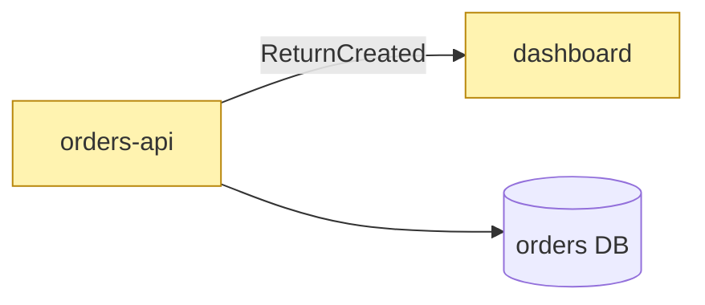

# Spec format

The issue body. `issue-to-pr` reads these headings by name, so keep them in English and in this order; write the content in the issue's language. Leave out a section only where this file says so.

````markdown
## Goal
- **Customer:** <E1: who gets what, one sentence>
- **Architecture:** <E1: which part of the system does what, one sentence>

## User stories
1. As <role> I want <x>, so that <y>.
2. ...

## Acceptance criteria
1. (Story 1 · S1) <Testable: a test at seam S1 can pass or fail on it.>
2. ...

## Out of scope
- <What this PR does not do, and where it goes instead (issue link) if anywhere. For a need of a later step: the addition it will fit in as (a new consumer, table, field, or event type).>

## Architecture diff

### Components


### Public API
```diff
  GET /orders → Order[]
+   returns: Return[]
```

### Data model
none

### Simplest variant
<= proposal | <variant>: <cost> · proposal: <cost> · reason: <why the simple one fails>

## Seams
- **S1** `<public interface: route, exported function, event, page>` · catches: <what a test there catches> · misses: <what it misses>
- ...

## Decisions
| Decision | Reason | Kind | Source |
| --- | --- | --- | --- |
| <what was decided> | <why> | long-term \| workaround: <the long-term change it postpones> | user \| <file:line, comment URL> |

## Assumptions
Leave out when there is none.
| Assumption | Evidence | If wrong |
| --- | --- | --- |
| <what the spec takes as given> | user \| <file:line, doc, comment URL> | <what breaks, or which work changes> |

## UI spec
Leave out when the change touches no UI.
- **Design artifact:** <URL>
- **Approved additions:** <component: tier (extend | new), reason no catalog component fits> | none

### <screen>-<state>
| Viewport | Spec |
| --- | --- |
| 1440 |  |
| 390 |  |

## Complexity
<S | M | L>: <reason: areas touched, API or data model changes>

## Affected areas
- `<path>`: <what changes there>

## Related
Leave out when there is nothing to link.
- Depends on #<n> / Part of a split with #<n>, #<n>
````

Rules for the Architecture diff:

- The three blocks Components, Public API, and Data model are always there, in this order. A block without a change says `none`.
- **Only the diff.** The diagram shows the changed nodes and their direct neighbors, not the whole system. A neighbor without a change has no class.
- **Fixed classes:** `added` green, `changed` yellow, `removed` red and dashed.
- **Public API and Data model** are `diff` blocks: unchanged context lines with two spaces, `+` and `-` for the change. Add an `erDiagram` only for a new entity. A public API is any contract another module, service, or client reads: HTTP routes, exported functions and types, events, queue messages, DB tables read by other services.
- Every API change shows its callers in `Affected areas`. A change that breaks a consumer outside the repo names its compatibility handling as a decision with source `user`.

Rules for Seams:

- A **seam** is a public interface a test observes behavior through, without reaching inside. Tests go only at the seams listed here; they are boundary decisions, approved with E2.
- One line per seam, numbered `S1`, `S2`, ...: the interface, what a test there catches, what it misses.
- Every acceptance criterion names exactly one seam from this list.
- On the fast path of `issue-spec` (complexity `S`, no public API, data model, or UI change), one line `S1 <existing test seam>` is enough.

`Affected areas` names paths, not slices: `issue-to-pr` cuts the slices. Implementation details (functions, helpers, file layout inside a module, test files and cases) do not go into the spec; `issue-to-pr` decides them within the seams.
